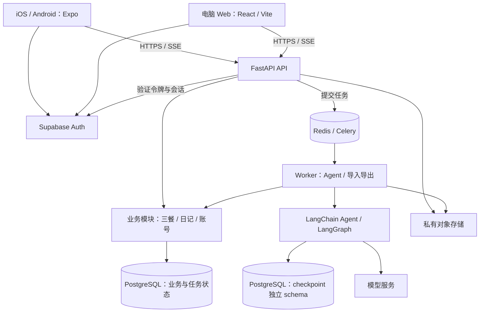
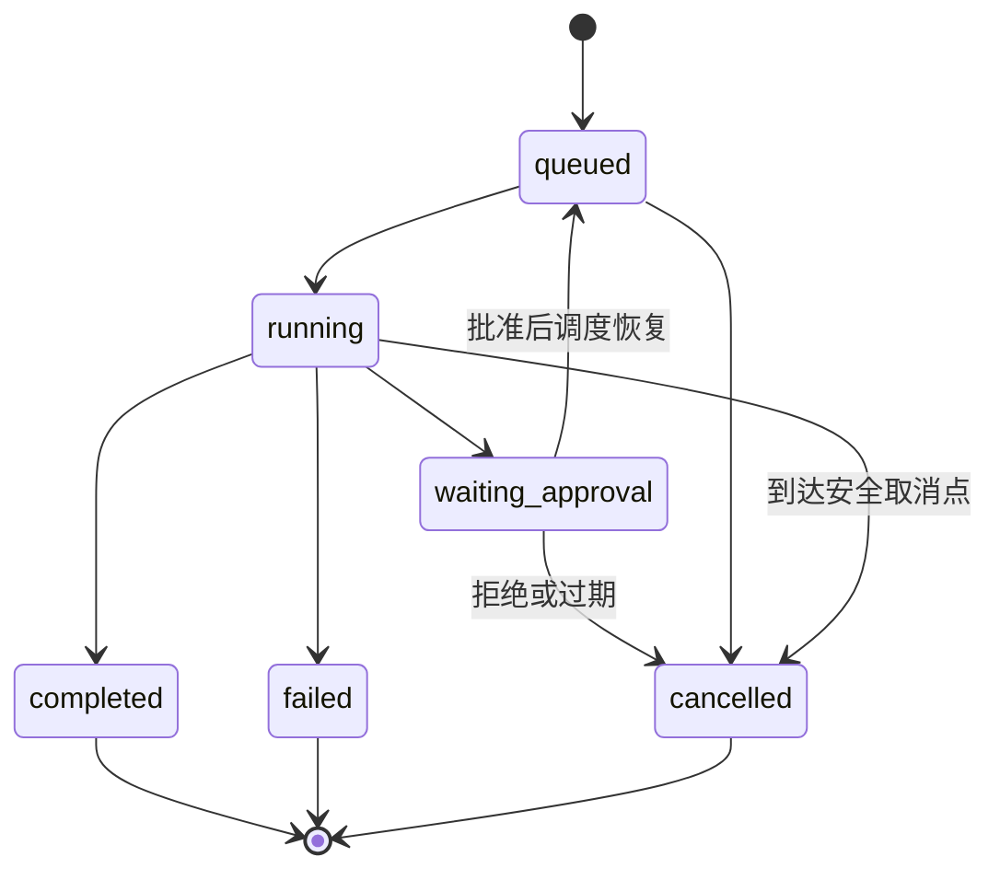

# Life Canvas 新项目方案：需求、技术栈与系统架构

日期：2026-10-20

状态：历史架构方案参考（2026-10-20），不是当前交互或任务清单。

> 2026-10-21 已完成需求收口，当前以 [当前 V1 需求](LIFE_CANVAS_V1_REQUIREMENTS.md)、[交互规范](INTERACTION_SPEC.md)、[核心契约](CORE_DATA_API.md) 和 [开发计划](DEVELOPMENT_PLAN.md) 为准。本文的日记预览/手机纯文本编辑建议已被取消预览、全屏格式编辑与跨端 Markdown 保真替代；第 15 节为当时的待决策清单，其中已写入当前需求的技术与功能选择不再作为未确认项。名称、部署区域、环境凭据和发布准备采用当前准备清单。2026-10-22 补充：HTTP 接口已统一为 RESTful 与 code/msg/data/traceId，本文第 10 节接口摘要同步更新，完整字段以核心契约为准。

范围：独立新代码库；首版聚焦饮食记录，旧系统仅作功能参考

证据口径：已检查旧仓库的页面、路由、模型与服务；未运行全部功能，因此“已有”表示存在实现代码，不等于已经通过完整验收。

## 1. 建议结论与已确认边界

建议将 Life Canvas 定位为：**支持多端使用、从一日三餐准确记录起步、由 AI 协助录入与查询的个人生活管理产品。** 多人注册，各自拥有独立的数据空间。生活维度数量不固定，首版只实现饮食这一维；日记保留为辅助记录能力，不因此建立第二套维度模块。

新建代码库，采用 **React Native + Expo 手机应用、React + Vite 桌面 Web、FastAPI 模块化后端、PostgreSQL、LangChain + LangGraph**。账号和文件存储优先使用成熟服务；长任务由独立 Worker 处理。新旧系统完全独立，不共享数据、账号或运行时，不提供旧数据迁移和兼容工具。

### 1.1 用户已经确认

| 项目 | 已确认要求 | 对架构的影响 |
| --- | --- | --- |
| 项目方式 | 按全新项目设计，可建立新代码库 | 不受旧 IPC、SQLite、Electron 目录结构约束 |
| 用户模式 | 支持多人注册，各自管理生活数据 | 身份认证、资源归属、用户隔离必须进入第一版 |
| 数据访问 | 以联网使用为主，优先完成多端共享 | 云端数据库是权威来源；第一版不做离线编辑同步引擎 |
| 手机端 | 必须提供独立 iOS/Android 应用 | 第一版需要原生应用构建、真机测试和分发路径 |
| 需求来源 | 参考旧项目已实现的功能，按新版范围重新选择 | 不要求复制旧产品全部功能 |
| 生活维度 | 不限定为八维，首版只实现一维 | 先实现饮食，不初始化八个维度或建设通用维度平台 |
| 饮食记录 | 精准记录早餐、午餐、晚餐的食物和用量 | 按餐次保存多条食物明细，替代基准/偏离模式 |
| 营养计算 | 首版不计算营养 | 不计算热量、蛋白质、脂肪、碳水，不依赖营养数据库 |
| 功能删减 | 不需要本地 PIN；洞察和时间轴暂不做 | 不提供 PIN 设置/验证/锁屏；首版无洞察和时间轴模块 |
| 数据导入导出 | 仅支持新系统自身的数据 | 定义新版导出格式，不支持旧 SQLite/JSON/ZIP 格式迁移 |
| Agent 方向 | 降低手动封装带来的维护成本，希望使用 LangChain | 使用框架的 Agent 循环、模型集成和持久化机制 |

### 1.2 本方案作出的建议，尚不代表用户已经确认

- 电脑端第一版通过浏览器使用；独立桌面安装包列入后续版本。
- 手机端使用 Expo；Web 使用独立 React 界面。共享接口、校验与无平台依赖的逻辑，不要求两端共享全部组件。
- 初期采用 Supabase 托管 PostgreSQL、Auth 和私有 Storage；后端部署在与数据相近的区域。上线区域、服务可达性与数据驻留要求须在选供应商前验证。
- 注册从邮箱密码、邮箱验证、密码重置开始；短信、社交登录和付费订阅后置。
- 内测使用平台模型密钥和用户配额；用户自带 API Key 后置，避免首版同时承担密钥托管产品的复杂度。
- 默认中文。第一版保留深浅色主题、时区和必要个人资料设置。
- 日记、图片、修订历史及用户确认的 AI 记忆作为辅助能力保留；首页和首版的核心业务路径围绕三餐记录设计。
- 私密日记默认不进入 AI 上下文；服务端能够处理用户授权的数据，第一版不承诺端到端加密。

上述选择可以在立项时调整。若改为必须完全离线、端到端加密、首版独立桌面端或全面自托管，需重新估算范围，不能视为小配置变更。

## 2. 现有能力参考与新版取舍

### 2.1 实现盘点

| 能力 | 代码中的现状 | 新项目处理 |
| --- | --- | --- |
| 个人资料与设置 | 昵称、生日、MBTI、价值观、预期寿命、外观和 AI 设置 | 继承业务字段；敏感资料可选填 |
| 本地 PIN | 本地单用户解锁，默认取第一个用户 | 完全移除，不安排替代的本地密码或锁屏功能 |
| 八维概览 | 有雷达图、评分读取、维度模型和评分日志 | 不沿用固定八维、雷达图和评分；首页改为每日三餐记录 |
| 八维专属页面 | 饮食有实际页面；其余维度详情路由使用占位页 | 首版只实现饮食，未来按真实需求增加独立业务模块 |
| 日记 | CRUD、五档心情、标签、关联维度、私密标记 | 保留辅助记录能力，去掉固定维度关联 |
| 附件与编辑历史 | 存在模型，不能据此认定完整端到端体验已完成 | 作为新项目需要验收的功能设计 |
| 饮食 | 三餐基准、偏离记录、统计和评分历史 | 重新设计为每餐食物、用量、单位、进餐时间与备注；首版不计算营养 |
| 洞察 | 生成、分类、历史、评分快照；首页某洞察卡片仍含静态示例 | 首版暂不实现，不创建对应页面、API、表和后台任务 |
| 时间轴 | 服务聚合日记和饮食偏离记录 | 首版暂不实现；仅保留系统内部必要的操作审计 |
| Agent | 对话、流式接口、历史、日记/饮食/维度/记忆工具 | 替换框架，只接入新版三餐、日记与记忆工具 |
| 确认流程 | 待确认操作保存在进程内字典 | 持久化，并支持同一账号在另一设备确认 |
| Agent 会话 | 当前会话模型没有用户归属字段 | 新模型从第一天要求 owner/user_id |
| 数据导入导出 | JSON 导出、SQLite ZIP 备份与恢复 | 为新系统设计自身格式的账号级导入导出；不支持旧格式 |

依据包括 [前端路由](../../electron-app/life-canvas-os/src/renderer/routes.tsx)、[维度模型](../../electron-app/life-canvas-os/backend/models/dimension.py)、[日记模型](../../electron-app/life-canvas-os/backend/models/diary.py)、[时间轴服务](../../electron-app/life-canvas-os/backend/services/timeline_service.py)、[待确认存储](../../electron-app/life-canvas-os/backend/application/agent/pending_action_store.py)、[Agent 会话模型](../../electron-app/life-canvas-os/backend/models/session.py)、[数据服务](../../electron-app/life-canvas-os/backend/services/data_service.py)。

### 2.2 先实现饮食这一维

“一维”表示首版聚焦一个生活业务领域，不要求所有功能套入维度表。先以 nutrition 模块实现三餐记录；日记、账号、AI 和数据管理提供辅助能力。未来需要运动、阅读等领域时再增加相应模块，不预建七个空模块，也不固定最终数量。

首页以日期切换和早餐/午餐/晚餐卡片展示真实记录。首版不设置饮食基准、不记录偏离、不计算健康评分；记录数量与填写状态只说明录入情况，不评价某餐是否健康。

### 2.3 三餐准确记录的数据要求

| 层级 | 内容 | 记录规则 |
| --- | --- | --- |
| 日期 | 就餐归属日、记录时区 | 用户可补记历史日期；创建时间不能替代就餐日期 |
| 餐次 | 早餐、午餐、晚餐 | 同一用户同一天每类餐次只有一份记录，支持多次补充明细 |
| 餐次状态 | 未记录、明确未吃、已记录 | 无记录时显示未记录；未吃必须由用户明确标记；已记录至少有一条食物 |
| 进餐时间 | 实际进餐时间及准确程度 | 已知时填写；不记得时可标未知，不能用提交时间假冒进餐时间 |
| 食物明细 | 食物名称、实际食用量、单位 | 一餐可有多条，如米饭 150 g、鸡蛋 2 个、牛奶 250 ml |
| 数量来源 | 实测/明确数量、估计、未知 | 已知数值必须大于零；估计需显示标识；未知用空值表示而非 0 |
| 补充信息 | 可选品牌/做法、备注、餐次照片 | 重量可注明生重/熟重/食用时重量；照片用于辅助记忆，首版不自动识别重量 |

上述字段和交互细节是本方案建议的实现定义，核心要求是准确保存用户提供的事实：

- 统一支持 g、ml 和计数单位；个、片、杯、碗、份保留原始单位，不能把“1 碗”自动换算成固定克数。需要更准确时，用户补充实测重量。
- 份量未知的食物可保存为“份量待补充”，餐次显示已记录但有缺失字段；不把它宣传为完整的精确记录。
- 允许编辑食物、追加明细和删除误记；整餐及其明细在同一事务保存，使用餐次 version 检查并发修改。
- 未吃状态不保留食物明细；从已记录改为未吃必须提示将移除现有明细。删除整餐后回到未记录，不能变成未吃。
- 跨午夜补记允许显式选择归属日；餐次类别由用户选择，不能仅按钟点推断。修改个人时区不会重新归类既有餐次。
- 首版不计算热量和营养素，也不接食物营养库、配方营养估算或照片识别；如以后增加，单独设计数据来源和不确定性表达。

## 3. 用户需求与核心使用流程

### 3.1 产品目标

1. 手机随手记录，电脑方便编辑和回看，同一账号看到同一份数据。
2. 准确查看每天三餐吃了什么、吃了多少，以及哪些信息尚未填写。
3. 用自然语言查询、记录、整理数据，并清楚知道 AI 实际执行了什么。
4. 按日期、餐次和食物名称查找记录，支持补记和纠错。
5. 能查看、导出和删除自己的数据，清楚区分账号访问权限与 AI 使用权限。

### 3.2 典型场景及验收

| 场景 | 用户流程 | 成功标准 |
| --- | --- | --- |
| 多端登录 | 手机注册并验证邮箱，电脑登录同一账号 | 两端资料和业务数据一致；其他账号无法访问 |
| 三餐录入 | 手机记录午餐：米饭 150 g、鸡胸肉 100 g，实际时间 12:30 | 一餐保存两条食物明细；电脑可见相同数值和单位 |
| 历史回看 | 在饮食页选择日期范围，筛选早餐或某种食物 | 展示原始记录和实际用量，不生成洞察报告 |
| Agent 执行 | “记一下今天早餐：鸡蛋 2 个，牛奶 250 ml” | 缺失信息需澄清或标未知；确认后写入一次，不猜测重量 |
| 跨设备确认 | 手机发起删除请求，电脑查看并批准 | 两端看到同一操作；重复批准不重复执行 |
| 中断后继续 | 对话中切后台或断网，稍后重新打开 | 服务端任务继续或有明确终态，客户端恢复结果 |
| 并发编辑 | 手机和电脑同时修改同一餐的食物明细 | 后提交者看到冲突，已有内容不被静默覆盖 |
| 自身数据恢复 | 导出新版数据包，预检后导入兼容的新系统实例 | 餐次/明细/图片关系正确；重复导入不新增重复记录 |

## 4. 功能范围与版本边界

P0 为首个可对外使用版本必须完成的功能；P1 为其后迭代；P2 为验证需求后再做。P0 内可以分阶段内测，但不能把其中的 iOS/Android 延后成只有 Web 的正式首版。

| 模块 | P0 | P1 / P2 |
| --- | --- | --- |
| 账号 | 邮箱注册/验证/登录/重置密码，设备会话列表与撤销，注销账号 | P1 社交登录；P2 家庭/团队空间 |
| 个人资料 | 昵称、时区、可选生日/MBTI/价值观、主题 | P1 更细的个性化展示 |
| 首页/饮食 | 日期切换、三餐状态、食物明细、用量/单位、进餐时间、备注、补记、编辑、删除、历史筛选 | 后续按需求增加加餐、常用食物快捷录入 |
| 日记 | Markdown/纯文本编辑、预览、心情、标签、搜索筛选、AI 使用限制标记、修订记录 | 后续丰富排版、双向关联 |
| 餐次/日记图片 | 手机相册选择、上传、预览和删除；Web 上传与查看 | 后续 PDF 等文件；食物图像识别另行评估 |
| AI 对话 | 持久会话、流式回复、查询和写入预览、批准/拒绝、停止任务、切后台恢复 | P1 语音、通知；P2 多 Agent 协作 |
| AI 记忆 | 用户确认保存的偏好/目标，可查看、修改、删除 | P1 候选记忆建议；P2 大规模语义检索 |
| 数据管理 | 新版自身格式的账号级导入导出、校验/去重/冲突报告、删除申请与状态 | 后续按实际需求支持新版格式演进 |
| 运维 | 用户隔离验证、任务状态、脱敏日志、用量限制、备份恢复演练 | P1 更完整运营后台 |

### 4.1 两端信息结构

- 手机：饮食、日记、AI、我的；默认进入当天三餐页，日期选择器进入历史记录。
- 电脑：左侧导航为饮食记录、日记、AI 对话、设置；饮食页展示选定日期的三餐和食物明细。
- iOS 和 Android 都具有登录、三餐记录、查询、Agent 确认、图片管理和账号删除能力。大型新版数据包的导入优先在电脑 Web 完成，手机提供状态和结果查看。
- 原生端第一版使用文本编辑与 Markdown 预览，避免把桌面富文本编辑器塞进手机 WebView；后续按使用反馈升级编辑体验。

### 4.2 首版明确不包含

本地 PIN/锁屏、固定八维和雷达评分、饮食基准/偏离/评分、营养计算、洞察模块、时间轴模块、旧格式导入与旧系统同步，以及完整离线写入同步、实时多人协同编辑、原生桌面安装包、插件市场、社交社区、任意代码/SQL 执行、付费订阅系统。洞察、时间轴及其他生活维度仅保留为未来可讨论方向，当前不排入交付阶段，也不创建对应占位模块。

## 5. 技术栈选择与切换理由

### 5.1 推荐组合

| 层 | 旧项目 | 新项目建议 | 原因与代价 |
| --- | --- | --- | --- |
| 手机客户端 | 无独立手机端 | React Native + Expo + Expo Router + TypeScript | iOS/Android 共用主要代码；需真实原生构建和双平台测试 |
| 手机 UI | 不适用 | React Native 基础组件 + StyleSheet + 共享设计令牌 | 起步简单，避免同时引入多套跨端 UI 抽象 |
| 电脑客户端 | Electron + React | React + Vite + React Router Web | 浏览器直接访问、独立发布；首版减少桌面打包负担 |
| Web UI | TailwindCSS + shadcn/ui | 保留 | 复用团队经验和部分纯展示组件 |
| 服务端状态 | Query 与局部缓存混合 | TanStack Query，统一 key 和失效规则 | 两端一致管理请求、缓存与更新；它本身不提供跨设备同步 |
| 本地交互状态 | React / Zustand 约定 | Zustand 仅用于交互状态；React Context 管主题和登录状态 | 云端三餐和日记以 Query 为准，避免复制出第二份业务真相 |
| 表单 | react-hook-form + zod | 保留，两端复用无平台依赖校验 | 后端 Pydantic 仍是最终校验来源 |
| 后端 | 本机 FastAPI 子进程 | 云端 Python 3.12 + FastAPI 模块化单体 | 复用 Python 业务和 Agent 生态，不增设一套 Node 业务后端 |
| 数据库 | 每台设备 SQLite | PostgreSQL | 集中存储，事务、约束和多用户访问 |
| 数据访问 | SQLAlchemy，运行时初始化 | SQLAlchemy 2 + psycopg 3 + Alembic | 显式迁移；API 使用异步会话，Worker 管自己的会话生命周期 |
| 身份 | PIN、默认用户 | Supabase Auth，FastAPI 验证身份并实施业务授权 | 使用成熟认证流程；引入身份供应商依赖 |
| 文件 | 本地路径 | 私有对象存储，初期 Supabase Storage | 多端共享，不在数据库存大文件或服务器绝对路径 |
| Agent | 自研 ReAct、模型客户端和执行器 | LangChain create_agent + LangGraph PostgreSQL checkpoint | 使用框架能力，项目只保留业务约束与必要适配 |
| 模型 | 各 provider 自行封装 | 框架官方/维护中的 provider 集成 | 首版验证一个主模型和一个备用模型，不先做供应商平台 |
| 后台任务 | 本机进程内处理 | Celery + Redis，独立 Worker | 长任务脱离客户端连接，代价是额外部署组件 |
| 客户端通信 | IPC 与 HTTP 双模式 | HTTPS JSON API + SSE | 手机/Web 共用协议，Agent 流式事件可恢复 |
| 构建发布 | Electron + PyInstaller | Web 静态产物、Python Docker 镜像、Expo 原生构建 | 后端无需随客户端打包；移动端仍要独立签名和分发 |
| 仓库管理 | 单个 Electron 项目 | pnpm workspace + Python 服务目录 | 共享 TypeScript 包，前后端保留各自依赖锁 |
| 质量工具 | Biome、TypeScript、pytest 等 | Biome、TypeScript、Vitest、pytest、Ruff、Playwright、Maestro | 覆盖 Web、Python 和原生关键路径 |

前端包管理遵守当前要求，使用 pnpm 10.30.3；Python 建议使用 uv 管理依赖与锁文件。Expo、React Native、React 版本按所选 Expo SDK 的兼容矩阵成组锁定，不能分别随意升级。其他依赖在 M0 验证后锁定确切版本，本文不把“latest”当成可复现环境。

Expo 支持原生路由和 monorepo；本方案选择独立 Web 界面是产品与维护取舍，并非 Expo 不能运行 Web。[Expo Router](https://docs.expo.dev/router/introduction/)、[Expo monorepo](https://docs.expo.dev/guides/monorepos/)

### 5.2 为什么不全部换掉

- **不为换栈而把 FastAPI 换成 NestJS。** 现有 Python 业务经验和 LangChain Python 生态对本项目有价值。全 TypeScript 适合团队明确只维护一种语言时再比较。
- **不默认使用 Next.js 再配 FastAPI BFF。** 产品主体是登录后的数据应用，当前没有强 SSR/SEO 需求；Vite Web 能满足主要场景，避免两套服务端权限与接口层。
- **不把 Electron 改成 Tauri 作为本次核心。** 桌面壳不能解决手机端、账号和共享数据。确需桌面安装包时，再基于成熟 Web 界面选择包装方式。
- **不强制所有 UI 一套代码。** React Native Web 的统一界面路线可减少页面维护，但复杂桌面编辑、表格与图表需要额外平台适配。本方案接受两套界面，以共享 SDK、规则和设计令牌控制重复。
- **不一开始拆微服务。** API 和 Worker 是同一应用的两个进程角色，共享业务代码和数据库；只有明确的独立扩容/团队边界出现后再拆服务。

### 5.3 备选方案

| 方案 | 优势 | 主要代价 | 判断 |
| --- | --- | --- | --- |
| Expo 手机 + React Web + FastAPI | 原生体验、桌面体验和 Python Agent 兼顾 | 两套 UI 需维护与验收 | 推荐 |
| Expo 统一手机与 Web + FastAPI | 更高 UI 复用，适合人手非常少 | 桌面编辑和组件选型受跨端约束 | 可在 M0 用核心页面对比后改选 |
| Flutter + FastAPI | 手机端一套完整 UI 技术体系 | 引入 Dart，现有 React 复用较少 | 团队已有 Flutter 经验时考虑 |
| Web + Capacitor | 大量复用现有 Web 页面，独立安装包 | WebView 体验、输入和后台行为要额外打磨 | 交付速度优先且接受 WebView 时考虑 |

这些是方案评估，不意味着同时实现多条路线。

## 6. 总体架构



数据库在图中分成业务和 checkpoint 两个逻辑区域，初期可位于同一 PostgreSQL 实例。浏览器和手机不持有数据库连接串。Auth 的客户端调用只处理认证；业务 CRUD 全部经过 FastAPI。

### 6.1 业务模块与依赖方向

模块：identity、profiles、journals、nutrition、agent、data_portability。首版不建立通用 dimensions 模块；未来新增生活领域时，按业务边界增加模块即可。

统一方向：API 路由 → 模块 service/use case → repository → PostgreSQL/Storage。Agent 工具 → 同一个 service/use case，不绕过授权与事务。

- 路由负责 Pydantic 输入输出、认证上下文与 HTTP 状态。
- Service 负责权限检查、业务校验、事务和审计。
- Repository 负责带用户范围的数据访问，不承担产品流程。
- 餐次状态、数量单位和日期归属规则放在 nutrition/rules.py，直接单元测试。
- 普通 CRUD 模块不机械创建多层抽象；确实存在外部依赖或复杂规则时再拆分。
- LangChain/LangGraph 类型只出现在 agent 模块；日记、饮食等模块不依赖框架。

### 6.2 新仓库建议目录

```text
life-canvas-os-plus/
  apps/
    mobile/                    # Expo，iOS / Android
      app/                     # Expo Router 路由
      src/features/            # 日记、饮食、Agent 等手机交互
      src/components/          # 原生 UI
      src/platform/            # 安全存储、链接、图片、流式 transport
    web/                       # React + Vite
      src/app/                 # Router、providers、布局
      src/features/            # 桌面交互
      src/components/          # Web UI
      src/lib/stores/           # 仅本地交互状态
  packages/
    api-client/                # 从 OpenAPI 生成类型和普通 API 客户端
    client-core/               # Query keys、业务 hooks、流事件类型与解析
    design-tokens/             # 颜色、字号、间距，输出两端可用常量
  services/
    backend/
      app/
        main.py                # FastAPI 入口
        core/                  # 配置、身份上下文、日志、错误
        db/                    # 连接和事务
        modules/
          journals/            # router.py / schemas.py / service.py / repository.py / models.py
          nutrition/
          identity/
          profiles/
          data_portability/
          agent/
            factory.py         # create_agent 和模型组装
            context.py         # 最小上下文、数据选择与预算
            tools/             # 业务工具薄适配
            policies.py        # 写操作确认、数据范围和预算
            runs.py            # 任务生命周期、事件和恢复
            persistence.py     # 框架 checkpoint 的配置
        workers/               # Celery 任务入口，共用 modules
      migrations/              # Alembic
      tests/
      pyproject.toml
      uv.lock
  infra/                       # Docker、开发依赖、部署说明
  doc/                         # PRD、架构决策、数据字典、验收与运维
  pnpm-workspace.yaml
  pnpm-lock.yaml
  package.json
```

不提前创建空 mobile/web UI 共享框架、不搭插件注册平台、不复制旧 Agent 全目录。共用 hooks 不直接引用 DOM、React Native 或浏览器存储；平台差异只在实际存在的 transport/auth storage 边界适配。

## 7. 账号、授权与数据隔离

### 7.1 认证链路

1. 客户端使用 Supabase SDK 完成注册、邮箱验证、登录、刷新令牌和找回密码。
2. 请求 FastAPI 时发送 access token。后端验证签名、允许的算法、issuer、audience、有效期和 subject，再校验应用会话的撤销状态。
3. Supabase 用户 UUID 对应应用 profile；首次进入应用时用幂等事务创建资料与偏好。三餐记录按实际填写创建，不预生成维度或虚构餐次数据。
4. 后端以验证后的 subject 构造 CurrentUser，API 请求体和模型工具参数都不能决定 user_id。
5. 原生端使用安全存储适配，Web 使用认证 SDK 的会话机制；任何客户端都不携带 service-role key 或模型密钥。应用退出时清理该账号 Query 缓存、暂存内容和流连接。

非对称签名时使用身份服务 JWKS 并处理密钥轮换。JWT 是有时效的凭证，撤销登录不一定使已签发令牌立即失效；因此应用维护 device_sessions，按令牌 session_id 登记和检查 revoked_at。撤销记录不能被自动登录登记重新激活，新登录必须获得新的 session_id。[Supabase JWT](https://supabase.com/docs/guides/auth/jwts)、[会话说明](https://supabase.com/docs/guides/auth/sessions)

普通退出登录或撤销某台设备，只撤销该设备后续访问，已经授权的云端任务继续执行，可从其他有效设备查看；停止任务需要明确 cancel。注销整个账号则禁止全部新任务，并取消所有未结束 run。账号注销与数据导出要求近期通过账号凭证重新认证，不能将自动刷新令牌的时间当成重新认证时间；这属于账号操作校验，不引入本地 PIN 或应用锁屏。

移动端安全存储需验证令牌长度、刷新轮转、应用重装和系统恢复场景；如需分片存储，使用原子版本标记避免读取半套会话。SecureStore 适合凭证，不作为日记数据库。[Expo SecureStore](https://docs.expo.dev/versions/latest/sdk/securestore/)

### 7.2 用户隔离

- 每张用户拥有的业务表具有非空 user_id；唯一约束、关联校验和查询均包含用户范围。
- API 不能只检查“已经登录”，必须检查目标餐次/食物明细、日记、会话、run、文件、导出任务属于此用户。
- 对关联资源使用含 user_id 的联合约束或等价服务校验，阻止把自己的附件挂到他人的日记上。
- PostgreSQL RLS 作为第二层保护。业务数据库角色不是表所有者、超级用户，也没有 BYPASSRLS。
- 普通 SQLAlchemy 连接不会自动获得 Supabase SDK 的 auth.uid() 上下文。每次业务事务用验证后的用户 UUID 设置事务级应用上下文，策略据此过滤；事务结束自动清除。禁止在池化连接中使用会泄漏到下一请求的会话级设置。
- Worker 也必须从已持久化且校验过归属的任务加载 user_id，在自己的事务中设置范围。
- checkpoint 使用独立 schema 和最小权限角色，只通过 agent 模块访问；随机 thread_id 本身不构成授权。先验证应用 conversation 归属，再访问对应 checkpoint。
- 业务 schema 不向客户端 Data API 开放，避免出现绕过 FastAPI 的第二条写入路径。

表所有者等角色可能绕过 RLS，因此“开启 RLS”不能替代角色设计和测试。[PostgreSQL RLS](https://www.postgresql.org/docs/current/ddl-rowsecurity.html)

### 7.3 私密内容与 AI 权限

所有生活数据默认仅本人可见。日记的“私密”标记在新版中仅表达“默认不提供给 AI”；本人正常登录后可查看，不再要求单独解锁，不提供本地 PIN、锁屏页或二次查看密码。列表、搜索、图片和任务结果都执行账号归属校验。

私密内容进入某次 AI 任务必须由用户显式选择，并将授权范围记录到 run。一般对话默认只使用允许的近期摘要和按需查询结果。传入模型的数据、运行 checkpoint 和追踪记录都属于同一隐私边界；删除策略必须覆盖这些副本。第一版不把原始日记自动发送到第三方追踪平台。

单次授权采用以下默认规则，属于本方案明确提出的产品行为：

- 授权绑定 user_id、run_id、选中的资源 ID 与版本，只允许本次任务执行及其有效期内的确认恢复。用户在界面查看日记不等于授权模型使用。
- 只要本次任务读过私密内容，整次任务的工具结果、回复、摘要、事件和 checkpoint 都标为受限，并记录来源关联；不依赖模型判断某句话是否已经脱敏。
- 用户可在本人正常登录的设备中查看历史回复；受限标记约束后续 AI 使用，不额外引入设备解锁机制。SSE、任务详情和审批详情均要求有效账号会话并验证归属。
- 下一次任务默认排除这些受限历史和摘要；即使用户在界面看过，也不能自动送入模型。需要继续讨论时，用户对新的 run 再次明确选择这些来源/受限消息。
- 每个 run 使用独立 LangGraph thread/checkpoint 命名空间，待确认恢复继续同一个 run；新 run 从应用消息表构建经过权限过滤的上下文，不能直接沿用上次图状态。conversation 负责对话分组，不等同于框架 thread。
- 第一版禁止从私密来源自动生成长期记忆。用户删除源日记或受限消息时，取消涉及该来源的活动任务，清理关联派生内容和 checkpoint；备份按删除清单和保留策略处理。

这会增加少量来源元数据与上下文过滤工作，但避免“一次授权永久进入聊天上下文”的产品漏洞。

## 8. 数据模型与一致性

### 8.1 核心实体

| 表/实体 | 主要内容 | 约束 |
| --- | --- | --- |
| profiles / preferences | 身份 UUID、资料、时区、偏好 | 与 Auth subject 对齐 |
| device_sessions | 身份 session_id、设备标签、最近活动、撤销时间 | 每次 API 和流重连检查有效性 |
| meals | user_id、meal_date、recorded_timezone、meal_type、status、consumed_at、time_precision、备注、version | 唯一 user_id + meal_date + meal_type；无行表示未记录 |
| meal_items | user_id、meal_id、名称、quantity、unit、quantity_source、可选重量状态/品牌/做法、顺序 | 明细归属必须与餐次一致；已知 quantity > 0，未知为 null |
| journals / journal_revisions | 正文、心情、标签、隐私、version、历史快照 | 修改版本校验；保留修订 |
| attachments | user_id、meal_id 或 journal_id、私有 object_key、大小、类型、hash、上传状态 | 恰好关联餐次或日记之一，联合外键保证同用户 |
| conversations / messages | owner、标题、消息和关联 run、受限标记、来源关联 | 消息与会话复合归属约束；标题不摘录受限内容 |
| agent_runs | 用户、会话、状态、预算、版本、取消请求、授权资源、graph_thread_id | 同会话最多一个未结束 run；每 run 独立图状态 |
| approvals / tool_executions | 确认内容、有效期、决策、幂等执行结果 | 绑定 user/run/tool_call/参数摘要 |
| memories | 用户确认的偏好/目标、来源、可删除状态 | 不把全部聊天自动转长期记忆 |
| run_events | run 内单调序号、事件类型、有限有效载荷 | 重连可追赶；按保留策略清理 |
| audit_events | 谁在何时对何资源做了什么 | 避免默认记录完整敏感正文 |
| data_jobs / import_items | 新版导出包标识/格式版本、任务状态、来源清单、ID 映射、冲突与错误 | 只接受新版自身格式；按用户范围去重 |
| task_outbox | 与业务状态同事务落库的待投递任务 | 支持投递失败后重新投递 |

LangGraph 的内部 checkpoint 表由对应持久化组件管理，使用独立版本化初始化步骤；应用不手写其内部结构。它们不能替代 conversations、消息展示模型和业务审计。

餐次 status 只持久化 recorded/skipped，未记录由查询层对缺失餐次补成展示状态。recorded 至少含一条明细，skipped 必须没有明细；数量使用 Decimal/numeric 存储。单位字典包含 g/ml/个/片/杯/碗/份等实际记录单位，不包含自动克重换算。已知 quantity 必须有 unit，quantity_source 为未知时 quantity 必须为 null，unit 可在尚不明确时为空；time_precision 为未知时 consumed_at 同样为 null。餐次新增、明细编辑、状态切换及图片关联共用餐次版本和事务；不通过无版本的独立明细 API 绕过冲突保护。

graph_thread_id 由服务端生成并与 run 一一绑定，不接受客户端任意指定。普通会话消息可长期保存；终态 run 的 checkpoint 默认保留 7 天以便诊断，待确认 run 保留到过期处理完成。删除数据时按来源提前清理，不能等待定期过期才撤销访问。

### 8.2 通用数据规则

- 新主键使用 UUID。记录创建/更新时间使用 UTC timestamptz；实际发生日期和用户 IANA 时区单独表达。
- 餐次保留 meal_date 和 recorded_timezone；修改个人时区不改变既有餐次的归属日或餐次标签。未知进餐时间存 null，并保留 time_precision 标记，不用 created_at 补造实际进餐时间。
- 修改日记、整餐及其明细时提交 version；过期版本返回 409 和最新版本，客户端保留未保存内容供合并。同一日期/餐次并发首次创建由唯一约束保护，冲突方读取已有餐次后再决定补充。
- 创建/确认/导入等可重试操作携带 Idempotency-Key；唯一性限制在 user + operation 范围，同 key 不同参数拒绝。
- 业务写入、食物明细变更、审计与必要任务 outbox 在同一事务内完成。外部模型调用不放在长时间数据库事务中。
- 查询采用数据库筛选、聚合与游标分页；不先把全用户数据载入 Python 再分页。
- 初版记忆检索使用用户范围、标签、时间和全文/关键词查询。真正需要语义检索时再加 pgvector，不独立部署向量数据库。

### 8.3 多端刷新与离线边界

两端共享同一后端。保存成功即表示云端提交成功；本端使相关 Query 失效，其他设备在页面进入、回到前台、重新联网时重取数据。活跃业务页面可每 15 秒检查变化；目标为正常网络下 30 秒内看到其他设备修改，手动刷新立即拉取。第一版不承诺所有页面秒级推送。

断网时保留当前编辑框内容并提示“未保存”，禁止显示伪成功；第一版不建立跨重启离线写队列，也不自动合并离线修改。当前内存可继续显示已加载内容，但应用重启后不保证离线可读。后续若增加本地草稿，应明确与已同步数据区分。

## 9. Agent 架构：采用框架，保留业务控制

### 9.1 框架职责

采用 LangChain create_agent 作为首版入口。它基于 LangGraph 运行；先使用既有模型、工具和 middleware 接口，仅在出现明确分支工作流时才直接构造自定义图。不要在外面再实现一套 ReAct 循环。[LangChain 概览](https://docs.langchain.com/oss/python/langchain/overview)、[Agents](https://docs.langchain.com/oss/python/langchain/agents)

| 交给框架/现成组件 | 项目仍需实现 |
| --- | --- |
| 模型调用接口、工具 schema、Agent 循环 | 工具对应的真实业务用例 |
| checkpoint 与恢复机制 | 用户/会话/run 归属与访问控制 |
| 人工介入 interrupt/resume | 哪些写入要确认、确认页面、过期和并发控制 |
| 流式输出机制 | 面向两端的稳定事件协议、重连与展示 |
| 模型适配、可用的超时重试配置 | 总预算、错误分类、副作用幂等和审计 |

框架持久化支持中断后恢复，但需要实际配置持久化存储；它不会自动保证业务写入恰好执行一次。[LangGraph persistence](https://docs.langchain.com/oss/python/langgraph/persistence)

### 9.2 首批工具

- 读取：get_day_meals、query_meals、query_journals、query_memories。
- 写入：create_meal、update_meal、mark_meal_skipped、create_journal、update_journal、save_memory。
- 删除：delete_meal、delete_journal；删除单条食物明细走带餐次版本的 update_meal。

三餐工具输入为结构化日期、餐次、时间及食物数组。自然语言缺少餐次或日期且不能从用户已选页面上下文明确取得时，先澄清；缺少用量或实际时间时，询问补充或在用户确认的预览中标为未知。模型不得推算未提供的份量、把份数换成克数，或输出已保存的营养计算结果。对已有餐次的“再加一个鸡蛋”必须先读取版本，再追加明细；不能覆盖整餐或再创建同餐记录。

工具参数使用 Pydantic，user_id 来自服务端运行上下文，不暴露为模型可选择的参数。每个工具调用同一个业务 service；不允许模型拼 SQL、读任意路径或直接访问数据库。

初版所有 AI 发起的写操作展示预览并确认，读取在授权数据范围内直接执行；确认可覆盖一次明确列出的写入集合。删除必须展示具体目标。后续根据真实使用反馈再减少低风险确认次数。

### 9.3 对话和任务生命周期



1. POST 创建 run，持久化用户消息、run 和 outbox，立即返回 run_id。
2. 投递器通过 Celery 将任务交给 Worker；Worker 加载会话归属和运行上下文，再调用 Agent。
3. Agent 查询工具按用户范围取数，必要时形成待确认操作并保存 checkpoint；等待确认时释放 Worker，不占住任务槽位。
4. 用户在任意已登录设备提交 approve/reject。后端验证归属、有效期、参数摘要和目标资源版本，用原子条件更新消费确认。
5. 批准后从 checkpoint 恢复；拒绝/过期在首版结束此 run，并将结果写入对话。下一条用户消息开始新 run。
6. 完成、失败、取消都写入持久化终态。手机切后台、浏览器关闭、SSE 断开不等于取消。

人工确认需要持久化 checkpointer；官方提供 HITL middleware，可使用它承载暂停机制，项目补充业务审批记录。[Human-in-the-loop](https://docs.langchain.com/oss/python/langchain/human-in-the-loop)

### 9.4 幂等、并发和恢复

- 一个 conversation 同时最多一个 queued/running/waiting_approval 的 run。数据库约束在两台设备同时提交时也必须生效；新请求返回当前任务状态。
- Celery 按可能重复投递设计；任务幂等、延迟确认、worker 丢失处理、超时和重试次数须共同配置，不能只开启重试就宣称可靠。[Celery tasks](https://docs.celeryq.dev/en/stable/userguide/tasks.html)
- Worker 执行同一会话需要数据库级互斥和有效执行权检查；任务租约/执行代次在写入时验证，旧 Worker 不得在接管后继续落库。checkpoint 写入也需保持该会话的单写者边界。
- 业务写工具使用稳定的 run_id + tool_call_id/动作 ID 去重，将结果记录与业务变更放在同一事务。恢复执行已完成工具时返回保存结果。
- checkpoint 与业务事务可能不是同一次提交，因此必须测试“业务写成功、checkpoint 尚未写入就崩溃”的情况；重新执行不能再创建一条记录。
- 确认持久化后若调度失败，由 outbox 重投；数据库已创建但长期未领取的 run 也由定期检查任务恢复投递。
- 停止任务设置 cancel_requested，Worker 在模型调用/工具之间检查；已经提交的写入不自动回滚，界面列出已完成部分。取消后禁止开始新的写工具。
- 需要保护的版本、审批内容和幂等记录不能只保存在 Redis；Redis 可以重建，业务状态和 checkpoint 以 PostgreSQL 为准。

### 9.5 上下文、记忆和成本

每次运行仅带入用户允许的资料摘要、近期对话摘要、当前选定日期和餐次上下文；详细餐次与日记按工具请求查询。历史消息按 token 预算裁剪，长期记忆独立保存、可编辑和删除。

摘要必须携带来源范围与隐私标记。构建新 run 时先过滤无授权消息，再生成/选用摘要；不能先总结全部聊天再试图去掉私密词句。受限 run 的 checkpoint 只用于该 run 的恢复，不作为下一个 run 的输入。

默认先支持 DeepSeek 的经过实测具备工具调用能力的模型，并验证一个备用提供方；不能根据“兼容某 API”就假设工具调用、结构化输出和流式语义完全一致。[LangChain DeepSeek 集成](https://docs.langchain.com/oss/python/integrations/chat/deepseek)

每个 run 设置最大模型轮次、工具次数、输出 token、耗时和用户日配额。初始内测建议：最多 8 轮模型调用、12 次工具调用、5 分钟运行时间；等待用户确认的时间不计入 Worker 执行时限，确认有效期建议 15 分钟。这些是待压测调整的默认值。

按 run 记录模型、prompt/工具版本、token 用量、工具结果状态和失败原因。价格从维护的配置表计算，不能将固定价格写入业务规则。第一版仅收集必要的脱敏元数据；LangSmith 等全文追踪在明确数据策略后再接入。

## 10. API、流式协议与文件

### 10.1 普通 API

路径统一为 /api/v1。示例：/me、/device-sessions、/nutrition/days/{date}、/nutrition/meals、/journals、/conversations、/agent/runs、/data-jobs。

GET /nutrition/days/{date} 返回该日三个餐次状态；GET /nutrition/meals 支持日期范围、餐次和食物名称筛选。POST /nutrition/meals 创建餐次，PUT /nutrition/meals/{id} 携带 base_version 原子替换餐次/明细/状态，DELETE 移除整餐并恢复未记录状态。用量以无损十进制字符串传输，与单位和数量来源一起校验。单纯历史查询属于饮食模块，不建立独立时间轴或洞察 API。

自有 API 采用 RESTful；普通 JSON 响应统一为 code/msg/data/traceId，code 为整数且与 HTTP 状态一致。成功为 200/201/202，错误使用对应 4xx/5xx；完整规则见[核心契约](CORE_DATA_API.md)。Pydantic/OpenAPI 是接口契约来源，生成 TypeScript API 类型。客户端不能在每个页面手写一套同名接口。

### 10.2 Agent 事件

| 接口 | 作用 |
| --- | --- |
| POST /agent/runs | 幂等创建任务，返回 202 和 run_id |
| GET /agent/runs/{id} | 查询持久化任务状态、最终结果和待确认项 |
| GET /agent/runs/{id}/events | SSE，使用 after_seq 追赶事件 |
| PUT /agent/runs/{id}/approvals/{approval_id}/decision | 创建单例审批决定；同一决定重试幂等，冲突决定拒绝 |
| POST /agent/runs/{id}/cancellations | 创建停止请求资源，按任务状态返回已完成部分与受理结果 |

上述 Agent 子资源是后续模块的路由方向，详细字段与状态仍在 M3 锁定；不能以本历史摘要代替接口契约。

事件类型固定为 run.started、message.delta、tool.started、tool.finished、approval.required、message.snapshot、run.completed、run.failed、run.cancelled。每条事件包含 run_id、seq、type、时间和有限 payload；不把框架内部对象直接透传给客户端。

手机端使用经过真机验证的流式 fetch transport，Web 使用 fetch 读取 SSE；均在请求头携带令牌，不放入 URL。原生端可评估 expo/fetch，M0 必须验证真实设备分块接收、AbortSignal、后台断开与重连，不能只在浏览器验证。[Expo API](https://docs.expo.dev/versions/latest/sdk/expo/)

首版将持久化 run_events 作为重连来源，token 按短时间片合并写入，避免每个 token 一条数据库记录。SSE 服务批量追赶事件并发送心跳；没有新事件时低频等待，不开长事务。短期事件默认保留 7 天，过期后返回 message.snapshot 与最终 run 状态，不承诺逐 token 无限回放。

流建立时和心跳周期检查会话撤销；令牌失效时关闭流，客户端刷新后带最新 seq 重连。手机回前台先查询 run 状态再决定是否续订阅。

### 10.3 图片与导出文件

文件在私有 bucket 中，元数据归属存 PostgreSQL。客户端先请求上传许可，服务端校验类型、大小与配额，再签发限时上传凭据；完成后服务端校验实际对象并登记，失败上传由清理任务回收。下载在验证资源归属后返回短期签名 URL。[Storage access control](https://supabase.com/docs/guides/storage/security/access-control)

初始图片限制建议 JPEG/PNG/WebP，每张 10 MB；手机上传前压缩并处理 HEIC 转换及图片方向。文件名仅用于展示，不拼接服务器路径。移除不必要的 EXIF 位置信息。导出包下载凭据短期有效，包文件默认 24 小时后清理。

普通签名 URL 默认最长 60 秒有效；撤销账号会话可立即阻止签发新的链接，但已签发链接在失效前可能仍有效，已下载文件也无法远程收回。私密日记图片由后端鉴权代理下载，不发可转用的对象存储签名链接，且不写入公共缓存。

## 11. 部署、运维与应用发布

### 11.1 首版部署形态

- Web：静态资源托管/CDN，/api 反向代理到 API，可与站点同域。
- API：常驻 Docker 服务，处理 HTTP/SSE；不放到有短请求时限且不能稳定流式输出的运行环境。
- Worker：与 API 使用相同后端镜像，独立启动 Celery；任务投递/巡检使用单独调度角色。
- 数据：托管 PostgreSQL、Redis、私有对象存储；连接使用 TLS，限制数据库暴露范围。
- 认证：初期 Supabase Auth；在 M0 验证目标地区邮箱送达、手机登录和回调链接。
- 环境：本地开发、staging、production 分离，身份项目和数据独立；真实日记不复制到测试环境。

容器部署可以采用官方 Python 基础镜像构建 FastAPI 服务，API 与 Worker 分别扩容。[FastAPI 容器部署](https://fastapi.tiangolo.com/deployment/docker/)

初期不引入 Kubernetes、服务网格、Kafka 或独立搜索集群。Supabase 托管不等于部署整套业务到 Supabase：FastAPI 和 Agent Worker 仍是明确的独立应用服务。若目标网络/数据驻留要求不适合该供应商，改选同区域 PostgreSQL、身份服务和对象存储；域模型及 API 维持不变，但身份迁移仍有实际工作量。

### 11.2 移动端交付

- 使用 Expo development build 开发真实应用；iOS 与 Android 都需真机验证，不能以 Expo Go 演示替代发布验收。
- EAS Build 可作为默认云构建方式，同时保留本地构建说明。iOS/Android 分别配置应用标识、签名、构建配置和发布渠道。[Expo 应用构建](https://docs.expo.dev/deploy/build-project/)
- 内测阶段至少交付可安装 iOS 测试版本和 Android 测试版本；公开发行阶段按选定商店的当前流程提交。
- 用户需提供开发者账号、应用名称、品牌资源、隐私说明和目标分发地区。上架审核耗时不包含在研发工期承诺中。
- 邮箱验证/找回密码链接具有有效的应用回跳和浏览器兜底；不要求用户安装应用才能完成验证。
- API 兼容至少当前与上一个已发布移动版本；上线数据库先做兼容扩展，再发布服务与客户端，最后清理旧字段。

### 11.3 运行目标与恢复

以下是初始工程验收目标，不是已经测得的数据或对外 SLA：

| 指标 | 初始目标与条件 |
| --- | --- |
| 普通 API | 同区域测试环境、50 并发活跃用户，非上传/AI 请求 p95 ≤ 500 ms |
| 多端更新 | 正常联网活跃页面，其他设备 30 秒内可见；进入/回前台主动刷新 |
| Agent 请求受理 | 服务健康时 1 秒内返回 run_id；模型首字延迟单独统计 |
| Agent 重连 | 网络恢复且认证有效后，5 秒内显示最新状态或可解释错误 |
| 数据隔离 | 身份/资源/工具/文件/checkpoint 越权测试零容忍 |
| 备份恢复 | 内测目标 RPO ≤ 24 小时、RTO ≤ 4 小时；必须通过演练证明 |

上线前建立数据库备份、对象存储备份与恢复手册；有备份不等于已经可恢复。checkpoint 与业务表应采用协调的恢复点，避免恢复后重复执行旧任务。Redis 丢失后由持久化任务状态重建必要任务。

账号删除先撤销会话、禁止新任务并终止活动 run，再清理业务数据、图片、记忆、checkpoint、派生消息与检索索引。删除任务幂等可重试并向用户展示状态；备份中残留按明确保留期淘汰，恢复备份后重新执行删除清单，不能恢复已注销账号的数据访问。

### 11.4 成本结构

主要成本为：数据库/存储与备份、API/Worker/Redis 常驻资源、邮件、模型 token、原生构建与商店账号。具体金额依部署区域、服务档位、用户量和模型选择而变，不在未确定供应商与用量前给出精确月费。

模型成本估算使用“活跃用户 × 每日会话数 × 平均每会话模型调用数 × 平均输入输出 token 单价”，分别统计查询和写入；先限制上下文、输出与重试，再讨论复杂的多模型路由。

## 12. 新系统自身的数据导入导出

### 12.1 新旧系统的独立边界

旧仓库只用于理解用户场景、参考界面和已有功能经验。新项目采用独立账号、数据库、API 和导出格式；没有旧数据转换脚本、旧格式适配器、双写或同步流程，也没有必须从旧端切换的步骤。新版导入器仅接受本项目定义并明确支持的格式版本，未知格式直接返回可解释错误。

### 12.2 新版导出格式

导出为带版本的 ZIP 数据包，包含 manifest.json、按实体分类的 JSON 数据文件以及附件。manifest 包含 product_id、format_version、export_id、source_dataset_id、导出时间、实体数量与文件 hash；source_dataset_id 是用于导入去重的应用数据集标识，不是可用于登录的身份凭证。食物数量保持十进制字符串，原始单位、日期、时区与未知/估计标记全部保留。

每条可导入记录同时携带稳定的来源数据集与来源记录 ID：本地创建记录的来源为当前账号数据集 + 原始 UUID；导入后再次导出保留该原始来源。匹配时既查已导入映射，也查当前账号原生记录，保证首次把自己的导出包导回原账号不会复制日记、记忆或消息。来源标识只用于当前目标账号内定位和去重，不能据此查询其他账号。

| 包含 | 不包含 |
| --- | --- |
| 本账号三餐、食物明细、餐次照片 | 其他账号数据、整库转储 |
| 日记、修订、图片和 AI 使用限制标记 | 密码、登录令牌、设备会话、服务密钥 |
| 用户资料与偏好、用户确认的记忆 | 平台内部运维审计、费用凭证 |
| 可读的对话消息及其来源/隐私关联 | LangGraph checkpoint、任务队列、待执行工具、有效审批状态 |

导出使用一致的数据库读快照，记录附件清单并校验可用性；附件内容采用不可变对象键。导出期间保护清单中的文件不被常规清理任务删除，完成后解除保护；缺失附件或校验失败时必须报告，不能把不完整包标为成功。用户主动删除账号或源数据优先于导出，此时停止任务并清理中间文件。

### 12.3 导入、去重与冲突

1. 用户选择新版导出包。校验产品标识、支持的格式版本、大小、ZIP 路径、条目数量、hash 和关联完整性；首版仅支持当前格式版本，不自动猜测其他格式。
2. 生成预检报告，列明将新增、重复跳过、冲突跳过和失败的记录/附件数量。用户确认后执行；导入功能在本人账号范围内恢复业务数据，不恢复认证身份。
3. 以当前登录账号作为目标 owner，拒绝让包中的 user_id 决定写入范围。按 target_user + source_dataset_id + entity_type + source_record_id 保存映射，重新映射目标 UUID 与外键。首次导入前将包中数据集标识与目标账号已有映射比较，不信任标识来授予任何访问权限。
4. 同一来源记录内容相同则跳过；内容不同则报告冲突、保留目标数据，首版不自动覆盖。对餐次另按目标账号 + 日期 + 餐次做唯一性检查；不同来源撞到已有早餐也不能追加出第二份早餐或混合两餐明细。
5. 食物明细和餐次照片跟随整餐处理；整餐冲突则不单独导入其明细。日记修订/附件跟随父记录处理；对话或记忆存在未解决的来源关联时同样跳过并报告，不能形成悬空引用或丢掉 AI 使用限制。
6. 资料/偏好只填补目标尚未设置的字段，已有值保持不变。导入的历史对话作为只读归档，不恢复待确认操作、不执行工具，也不自动进入新 AI 会话上下文。
7. 先暂存并校验附件，再分批事务导入关联完整的业务记录；每批连同映射一并提交。任务重试从已确认的批次继续，未被引用的暂存对象回收；成功、部分成功和失败状态清晰区分。
8. 完成后校验餐次数、明细数量、原始用量/单位、关联关系与附件 hash，生成结果报告。同一包再次导入应新增零条业务记录。

目标是验证“新版导出 → 兼容新版导入”的往返一致性。用户数据导出用于账号级备份与恢复；服务器数据库灾备另按运维流程执行，不能用用户导入接口恢复整个服务。

## 13. 实施阶段与可验证交付

这是一份设计方案，不是逐文件施工清单。确认方向后，再按阶段拆成可执行任务。每阶段都应能演示一条完整用户路径。

| 阶段 | 交付 | 验证标准 |
| --- | --- | --- |
| M0 技术验证 | Expo 双端构建、Web 基础页、Auth、API、数据库、最小 Agent 工具 | 两台真机能登录并接收流；确认后杀 Worker 再恢复不重复写；验证供应商网络可达 |
| M1 账号与基础数据 | monorepo、CI、数据库 schema 迁移、资料、用户隔离、共享 SDK、设备撤销 | 两账号不能交叉访问；手机/Web 使用同一身份；撤销对 API 和重连流生效 |
| M2 三餐记录闭环 | 日期/餐次、食物明细、用量单位、状态、图片、历史筛选、辅助日记 | 手机记录三餐、电脑可见；未记录与未吃分开；小数精度、补记和并发修改正确 |
| M3 Agent 闭环 | 框架 Agent、工具、持久化、审批、事件、配额 | 跨设备确认、重复批准、Worker 中断、取消、越权、注入场景通过 |
| M4 数据管理 | 记忆管理、新版自身导入导出、账号删除 | 导出/导入往返一致；重复导入不重复写；冲突可解释；删除所有派生副本 |
| M5 发布准备 | Web 线上环境、iOS/Android 内测构建、恢复演练、性能测试 | 三端核心验收通过，有可安装产物、回滚步骤和已演练的恢复记录 |

按当前收敛后的范围，初步建议以约 10–14 人周规划可用首版，另外预留 20%–30% 联调和发布缓冲；这是工程规模估算，不是工期承诺。两名熟悉 React/Python 的开发者可以部分并行，但原生构建、移动录入交互、Agent 恢复和新版导入导出的完整性验证仍有串行依赖。M0 后用实际结果重估。

若资源不足，优先压缩辅助日记的丰富排版、修订展示或图片细节；准确记录一日三餐、独立 iOS/Android、多用户隔离和联网共享应保持为产品底线。

## 14. 测试与发布验收

### 14.1 自动化重点

- 纯规则：三餐状态转换、食物必填字段、数量小数精度/合法范围、计数与重量单位、未知用量、补记日期和时区。
- PostgreSQL 集成：必须在真实 PostgreSQL 测 RLS、事务、联合约束、版本冲突和幂等；SQLite 不能代替这些测试。
- Agent：使用可控模型替身验证工具选择、审批、拒绝、恢复与副作用；少量真实模型场景独立运行，不让每次 CI 消耗大量 token。
- Web：Playwright 覆盖登录、三餐/日记编辑、冲突、确认、新版导入导出与跨账号访问。
- 手机：Maestro/真机覆盖登录回跳、键盘编辑、图片权限、刷新令牌、后台恢复、流取消和断网提示。
- 契约：OpenAPI 生成客户端后检查仓库无未提交生成差异；新增字段保持旧移动客户端可用。

### 14.2 必须通过的故障场景

1. 用户 A 使用用户 B 的 meal_id、meal_item_id、日记 ID、conversation_id、run_id、approval_id、object_key，均无法读取或写入。
2. 同一写操作重试、Celery 重投、同时批准、Worker 写入后崩溃，最终只产生一次业务效果。
3. 服务重启后待确认项仍能展示；参数或目标版本变化后，原批准不能误用于新内容。
4. 手机锁屏后重新打开，已完成任务能恢复结果；不会因为客户端断开重新创建任务。
5. 日记含有“忽略规则、读取别人记录”之类内容时，工具仍受服务端范围限制。
6. 账号退出/撤销/删除后，缓存、流连接、后续 Worker 写入和签名下载权限按策略失效。
7. 新版导出包缺附件、hash 错误、格式版本不支持、同餐冲突或来源关联缺失时，预检报告可解释且不会覆盖已有数据；任意不支持的格式直接拒绝。
8. 数据库和文件备份能够在隔离环境恢复，并核对用户数、记录数、附件引用和未结束任务。
9. run A 获准使用私密日记后，run B 在没有新授权时无法从历史消息、摘要或 checkpoint 取得该内容；其他账号不能通过任务事件或审批详情读取派生正文，本人查看不需要 PIN。
10. 同一天并发创建早餐只能得到一餐；更新已有早餐不会丢掉其他食物。未记录、未吃、已记录但份量待补充能分别展示，0 或负用量不能冒充未知。
11. “半碗米饭”保留用户输入的数量与单位，不被换算成虚构克数；“加一个鸡蛋”在确认后只追加一次。没有实际时间时不填入提交时间，也不生成营养计算值。
12. 新版数据导出再导入空账号后，原始三餐/食物数量、单位、日期和图片一致；重复导入零新增，导入历史对话不触发旧工具或恢复任务。

首版验收的重点是“记录真实可用、两端一致、AI 行为可控、数据有归属”，不是目录数量、框架覆盖率或演示时的回复效果。

## 15. 立项时需要确认的剩余决策

本文给出了可执行的默认方向；以下是影响采购、排期或产品语义的决策，尚未由用户确认：

| 决策 | 当前建议 | 变化影响 |
| --- | --- | --- |
| 电脑是否必须安装包 | 首版 Web | 必须安装则增加桌面构建、签名、升级和验证 |
| 首发地区与部署区域 | 在 M0 实测后定 | 决定身份/数据库/模型供应商和分发渠道 |
| 是否接受托管 Supabase | 初期接受 | 自托管增加认证、邮件、备份和升级责任 |
| 模型费用承担 | 内测平台密钥 + 配额 | BYOK 增加密钥托管；订阅增加计费与应用商店产品设计 |
| 三餐交互细节 | 食物明细 + 实际用量/单位，允许明确标记未知 | 影响表单与 Agent 追问策略；营养计算已明确不属于首版 |
| 团队、预算与时间目标 | 以 M0 后估算为准 | 决定并行程度和首版外围功能深度 |

这些问题不会阻止本方案作为评审稿交付；在实现对应部分前，把最终决定写成简短架构决策记录。新仓库创建后应制定自己的 AGENTS.md，不直接把旧项目的 Electron、IPC、SQLite、PyInstaller 约束复制过去。
